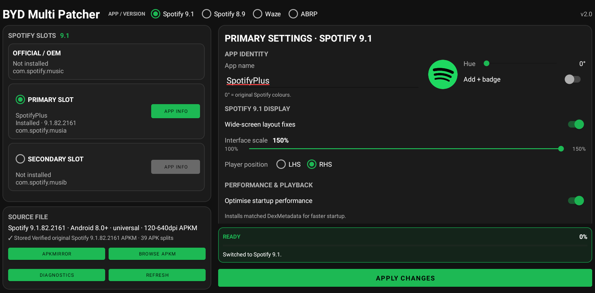
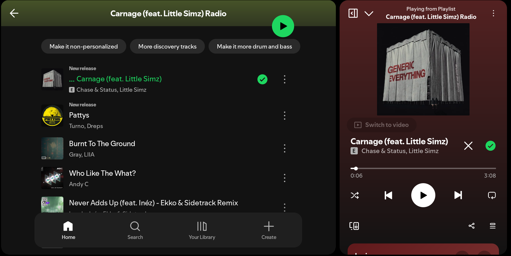
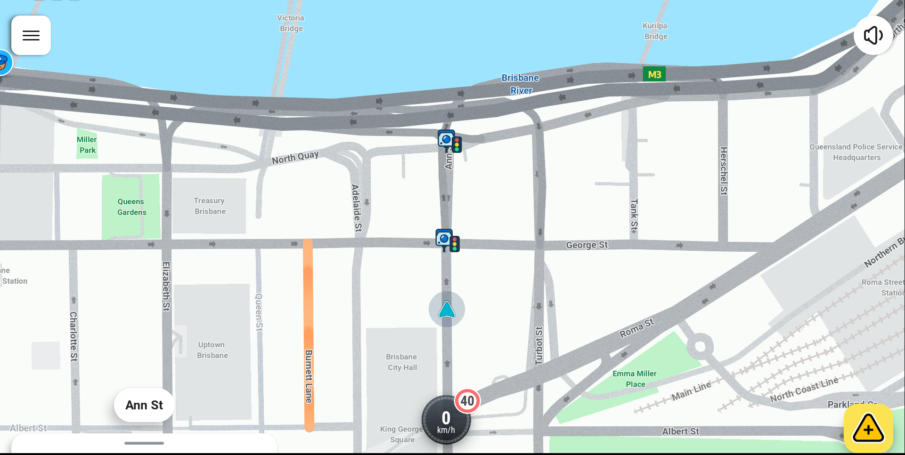
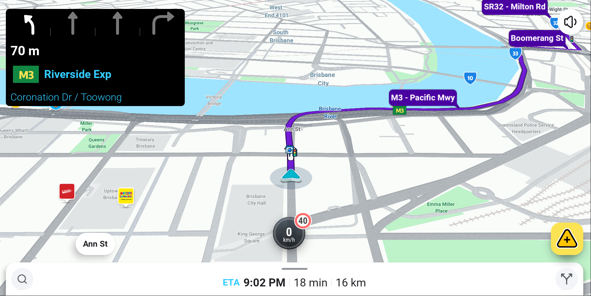
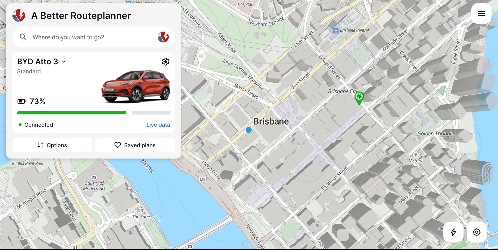
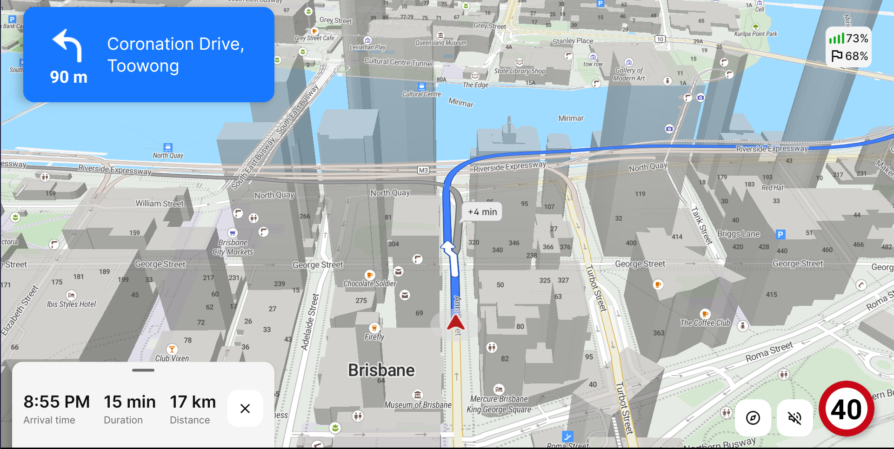

# BYD Multi Patcher v2.0

BYD Multi Patcher modifies supported Spotify, Waze and A Better Routeplanner builds for BYD Android head units.

The project started as BYD Spotify Patcher. Version 2 expands it into one patcher for Spotify, Waze and ABRP.

## What changed in v2

- Added **ABRP**, **Waze** patching.
- Updated **Spotify 9.1** version.
- Project now uses APKM files instead of APK. APKMs are smaller and easier to find.
- Renamed the project from **BYD Spotify Patcher** to **BYD Multi Patcher**.

## Supported profiles

- **Spotify 9.1.82.2161**
- **Spotify 8.9.76.538**
- **Waze 5.24.0.1**
- **ABRP 7.1.7**

## Spotify 9.1 options

Spotify 9.1 currently supports:

- BYD wide-screen layout fixes
- Interface scale: 100%-150%
- 115% default interface scale
- Player position: LHS or RHS
- Custom visible app name
- Launcher icon hue adjustment
- Optional `+` launcher badge
- Optional optimised performance profile
- v2 Improved playback restoration after vehicle restart

## Spotify 8.9 options (recommended for slower BYD hardware)

Spotify 8.9 currently supports:

- Stock, Moderate or Large font size
- Left / LHD side panel
- Right / RHD side panel
- BYD landscape/orientation fix
- Custom visible app name
- Launcher icon hue adjustment
- Optional `+` launcher badge
- v2 Improved playback restoration after vehicle restart

## Waze

Waze is patched specifically for the wide BYD display rather than simply scaling the normal phone/tablet interface.

Main changes include:

- Centres the map and car position for the full-width display.
- Repositions the speedometer around the vehicle marker.
- Resizes the navigation instruction panel.
- Moves the top navigation controls down so they sit correctly on the BYD screen.
- Adjusts route-preview and active-navigation map positioning.
- Reduces the bottom drawer height to leave more map visible.
- Hides the Waze audio/music button by default.
- Applies EV defaults including CCS2.
- Optional microphone button removal.

## ABRP

ABRP 7.1.7 gets direct integration with the BYD head unit.

Main changes include:

- Centres the map and car position for the full-width display.
- Resizes the navigation instruction panel. Adjusts buttons so they are not blocked by BYD top and bottom panels
- Reads the BYD traction-battery SOC directly from the car — no separate link app or OBD adapter required.
- Uses the native BYD/Telenav **Cerence** TTS engine for navigation instructions.
- Uses the built-in English **Zoe** voice and selects it automatically on a fresh install.
- Removes the reliance on Google location services and switches to using native Android location instead. This change resolves the location lag issue that the original application experienced when installed on BYD systems.
- Defaults Appearance to **Automatic (Day/Night)** on a fresh install.
- Keeps live BYD battery data available to ABRP while driving.

## Installation

1. Download the latest **BYD Multi Patcher APK** from the [Releases](../../releases) section and install it on your unlocked BYD infotainment system.

2. Make sure you have a non-stock browser and a file manager installed

   The stock BYD browser will block APK/APKM downloads.

   I recommend **Firefox**
   https://www.apkmirror.com/apk/mozilla/firefox/firefox-fast-private-browser-158-0-release/firefox-fast-private-browser-158-0-3-android-apk-download/
   
   And **Cx File Explorer**
   https://www.apkmirror.com/apk/cx-file-explorer/cx-file-explorer/cx-file-explorer-2-8-1-release/cx-file-explorer-2-8-1-3-android-apk-download/
   
4. Open **BYD Multi Patcher**.

   At the top you will see the available profiles:

   - Spotify 9.1
   - Spotify 8.9
   - Waze
   - ABRP

5. Select the profile you want to patch.

   Each profile has a button linking to APKMirror for the exact supported app version.

   Supported versions:

   - **Spotify 9.1.82.2161**  
     https://www.apkmirror.com/apk/spotify-ab/spotify-music-podcasts/spotify-music-and-podcasts-9-1-82-2161-release/spotify-music-and-podcasts-9-1-82-2161-android-apk-download/

   - **Spotify 8.9.76.538**  
     https://www.apkmirror.com/apk/spotify-ab/spotify-music-podcasts/spotify-music-and-podcasts-8-9-76-538-release/spotify-music-and-podcasts-8-9-76-538-android-apk-download/

   - **Waze 5.24.0.1**  
     https://www.apkmirror.com/apk/waze/waze-gps-maps-traffic-alerts-live-navigation/waze-navigation-live-traffic-5-24-0-1-release/waze-navigation-live-traffic-5-24-0-1-2-android-apk-download/

   - **ABRP 7.1.7**  
     https://www.apkmirror.com/apk/rivian-llc-2/a-better-routeplanner-abrp/a-better-routeplanner-abrp-7-1-7-release/a-better-routeplanner-abrp-7-1-7-android-apk-download/

6. Download the required APKM.

   You can either:

   - download it directly on the BYD system using Firefox, or
   - download it on another device or PC, copy it to a USB drive and connect the USB drive to the car.

7. Return to **BYD Multi Patcher** and press **Open APKM**.

   Select the file you downloaded. The patcher will verify that the app and version are supported.

8. Once verification passes, press **Install selected APK**.

   The patcher will first create the patched version of the app.

9. The first time you do this, Android will ask you to allow BYD Multi Patcher to install unknown apps.

   Enable **Allow from this source**, then return to BYD Multi Patcher.

10. Press **Install selected APK** again.

   The app will be patched and the standard Android installation window will appear.

11. Press **Install**.

    BYD may show the usual warning about installing third-party applications. Continue with the installation.

Once installation is complete, the patched Spotify, Waze or ABRP app is ready to use.

> **Important:** Use the exact app versions listed above. The patcher checks the source APK/APKM and will reject unsupported versions.
